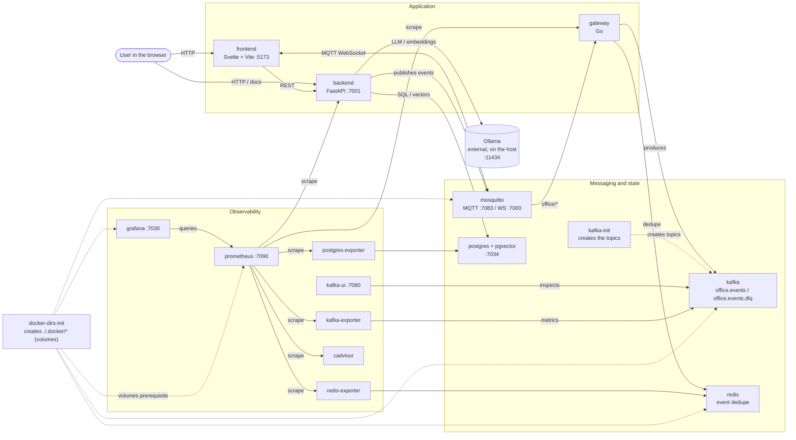
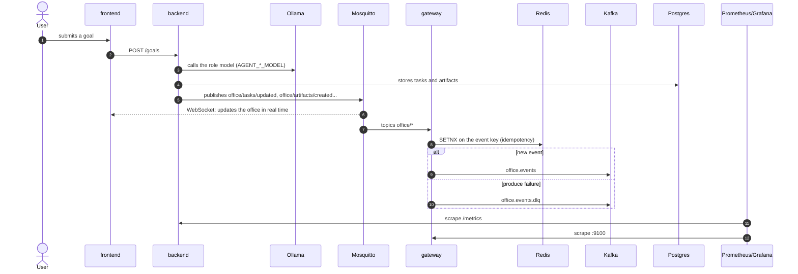

# AgentOffice Microservice

**🌐 Language:** English · [🇧🇷 Português (BR)](./README.md)

[](https://github.com/CristianBernardes/agent-office-microservice/actions/workflows/ci.yml)
[](./LICENSE) [](#-before-you-clone-or-fork--help-keep-this-project-alive)

▶️ **Watch the demo video:**

[](https://youtu.be/sAiGLPTWMv4)


> An IT office simulated by AI agents — each with its own role, personality and language model,
> collaborating in real time via MQTT to research, debate, decide and document, exactly like a
> real product/technology team would.

Give the team a product goal (e.g. *"build a niche SaaS to sell 5 units/day at $8"*) and watch the
agents think, research the market, debate with each other, and produce real artifacts — ADRs,
backlogs, test plans, market analyses — as versionable Markdown files, not just ephemeral logs.

**Open source** project, built from scratch following **Clean Architecture**, **SOLID**
principles, **Clean Code**, **DRY**, **YAGNI**, dependency injection, automated testing, and
rigorous architectural documentation (ADRs, RFCs, Design Docs).

---

## Screenshots


*The living office: agents at their desks, meeting rooms and the Scrum board.*


*Hiring an agent: the listed models come from the locally installed Ollama (`GET /models`), nothing hardcoded.*


*6-column Kanban board: backlog → todo → in_progress → testing → in_review → done.*


*Warning when switching language: changing it after the project started may corrupt files already written; confirmation is required.*


*Grafana dashboard: backend, gateway and Kafka metrics.*

---

## 💙 Before you clone or fork — help keep this project alive

This repository is **open source and free**, but it is maintained in the author's free time.
**Any donation amount is welcome**.

**I want to be upfront:** I take care of my daughter's health — she has several allergies — and
these costs have put me in **debt**. I genuinely need help, even though this is an open source
project. I would rather say this openly than use my daughter as an emotional hook: the project
stands on its own, donating is entirely voluntary, and nothing here depends on it. Donations help
pay off these debts and keep the time and energy available to continue developing AgentOffice.

If this project helped you, inspired you, or you simply want to see this idea grow well on
GitHub — please consider donating before you clone/fork below:

<div align="center">

<table>
<tr>
<td align="center" width="260">

**🌍 PayPal (International)**

Donations via PayPal are very welcome, from anywhere in the world:

<a href="https://www.paypal.com/donate/?business=cristian.aob%40gmail.com&item_name=Support+the+AgentOffice+project&currency_code=USD">
  
</a>

📧 Account: **cristian.aob@gmail.com**


**💜 GitHub Sponsors**

Monthly or one-time, directly through GitHub:

<a href="https://github.com/sponsors/CristianBernardes">
  
</a>

</td>
<td align="center" width="260">

**🇧🇷 Pix (Brazil only)**


Scan the QR Code with your Brazilian bank app

</td>
</tr>
</table>

</div>

<div align="center">

Any donation, of any amount, helps keep my family's health covered and this project's idea
alive — thank you! 🙏

</div>

---

## The Team

Nine roles, each with its own system prompt, personality (Big Five traits), and set of allowed
tools:

| Role | Main responsibility |
|------|----------------------|
| **Product Owner** | Backlog, user stories, prioritization |
| **Scrum Master** | Ceremonies, impediments, retrospectives |
| **Tech Lead** | Architecture, ADRs, technical decisions |
| **Senior Developer** | Implementation, code review, mentoring |
| **Junior Developer** | Simple tasks, learning |
| **QA Engineer** | Test plans, bug reports |
| **Data Analyst** | Metrics, KPIs, analyses |
| **HR Manager** | Onboarding, culture, hiring |
| **Product Consultant** | Market validation, research |

Each role can only use the tools assigned to it (e.g. only Tech Lead and Product Owner can
`approve_artifact`; only Scrum Master can `start_ceremony`) — permission validation is
centralized and never delegated to the LLM.

## How the Agents Work

```
User command
        │
        ▼
 Agent enters "thinking" state (status published via MQTT)
        │
        ▼
 LLM (local Ollama, or any OpenAI-compatible API) receives the
 role's system prompt + context, and decides: a thought, an
 action and, optionally, a tool to run
        │
        ▼
 Tool validated against the role's permissions and executed
 (e.g. web search, write/review/approve an artifact)
        │
        ▼
 Result published via MQTT to any consumer (other agents,
 frontend, observability)
```

The entire flow is event-driven over MQTT with a standard message envelope (`event_id`,
`timestamp`, `agent_id`, `agent_role`, `payload`) — see
[RFC-001](docs/rfc/001-protocolo-de-comunicacao-entre-agentes.md) (written in Portuguese, as all
internal design documentation of this project is).

## Container flow

Every service in `docker-compose.yml` and how they connect (volumes always under `./.docker/`):





| Container | Role |
|---|---|
| `docker-dirs-init` | Creates the volume directories in `./.docker/` and fixes permissions; runs once before the others |
| `frontend` | Svelte 5 + Vite UI (office, Kanban, hiring) |
| `backend` | FastAPI API (Clean Architecture): agents, tasks, Scrum cycle; talks to Ollama |
| `mosquitto` | MQTT broker (TCP and WebSocket) for real-time events |
| `gateway` | Go bridge: MQTT → Kafka, with Redis dedupe and DLQ |
| `kafka` / `kafka-init` | Event log and creation of the `office.events` and `office.events.dlq` topics |
| `redis` | Gateway dedupe (idempotency) |
| `postgres` | Persistence (+ pgvector) |
| `kafka-ui` | Browse topics, messages and consumers |
| `kafka-exporter`, `postgres-exporter`, `redis-exporter`, `cadvisor` | Export Kafka, Postgres, Redis and container metrics |
| `prometheus` | Scrapes all metrics |
| `grafana` | Dashboards on top of Prometheus |

**Ollama** runs outside Docker, on the host (see [Installing Ollama](#installing-ollama)).

## Architecture

### Backend (Clean Architecture)

```
┌──────────────────────────────────────────────────────────────────────┐
│                      MQTT BROKER (Mosquitto)                          │
│       office/agents/#  ·  office/artifacts/#  ·  office/tasks/#       │
└──────────────────────────────┬────────────────────────────────────────┘
                                │
┌───────────────────────────────▼────────────────────────────────────────┐
│                BACKEND (FastAPI, Python 3.12)                          │
│                                                                        │
│   presentation/  →  application/  →  domain/  ←  infrastructure/      │
│                                                                        │
│   domain/         pure entities (Agent, Artifact, Task), interfaces   │
│   application/    use cases (AgentThinkUseCase, WriteArtifact...)     │
│   infrastructure/ MQTT, Ollama, Tavily, PostgreSQL, filesystem        │
│   presentation/   HTTP routes and dependency injection                │
└────────────────────────────────┬────────────────────────────────────────┘
                                 │
       PostgreSQL + pgvector  ·  Ollama (host, outside Compose)  ·  Tavily
```

The golden rule of Clean Architecture: code dependency arrows always point inward. `domain/`
never imports anything from `infrastructure/`, `application/`, or `presentation/` — every
external dependency (LLM, database, messaging, web search, filesystem) sits behind a domain
interface, allowing the implementation to be swapped without touching business rules.

### Full product vision (planned end state)

```
┌───────────────────────────────────────────┐
│             WEB INTERFACE                  │
│  Svelte + TypeScript                       │
│  ├── Control panel                         │
│  ├── Agent list and state                  │
│  ├── Logs and notifications                │
│  └── Phaser: pixel-art office              │
└───────────────────┬─────────────────────────┘
                    │ WebSocket / HTTP
┌───────────────────▼─────────────────────────┐
│          COMMUNICATION GATEWAY (Go)         │
│  ├── Real-time API and connections          │
│  │   with the frontend                      │
│  └── BRIDGE between MQTT and the Python     │
│      backend: routes MQTT ⇄ Kafka, with     │
│      idempotency (Redis) and per-agent      │
│      ordering                                │
│  (no authentication — open source project,   │
│   funded by donations, no sensitive data)    │
└───────────────────┬─────────────────────────┘
                    │
┌───────────────────▼─────────────────────────┐
│                MQTT (Mosquitto)             │
└───────────────────┬──────────────────────────┘
                    │
┌───────────────────▼─────────────────────────┐
│          PYTHON BACKEND                     │
│  AI execution                               │
│  Orchestration                              │
│  Tools                                      │
└───────────────────────────────────────────────┘
```

The frontend (Svelte + Phaser.js, pixel-art) is part of the full product vision and is not
implemented in this repository yet. The Go gateway (MQTT → Kafka with dedupe and DLQ, see
[ADR-024](docs/adr/024-gateway-go-mqtt-kafka.md)) already exists in [`gateway/`](gateway/); serving
the frontend in real time is still pending. See details in
[`docs/design/arquitetura-geral.md`](docs/design/arquitetura-geral.md) and the full migration
plan in [`docs/migration-plan/fase-8-microservicos/`](docs/migration-plan/fase-8-microservicos/README.md)
(both written in Portuguese).

### Artifacts as first-class citizens

Agents don't just "chat" — they produce real, versionable documents with an explicit lifecycle:

```
DRAFT → IN_REVIEW → APPROVED → ARCHIVED
```

Every artifact is persisted as a real `.md` file under `workspace/projects/{sprint}/`, with YAML
frontmatter (author, type, status, dates), and every state transition publishes an MQTT event —
see [RFC-002](docs/rfc/002-sistema-de-artefatos.md).

### Web search

Some roles (Product Owner, Tech Lead, Developers, Data Analyst, Product Consultant) have access
to the `web_search` tool, backed by [Tavily](https://tavily.com) — a search API built for AI
agents — see [ADR-011](docs/adr/011-tavily-como-provedor-de-busca-web.md).

## HTTP API

Interactive docs at `/docs`. Error messages follow the `Accept-Language` header (`pt` or `en`).
Full contract: [RFC-004](docs/rfc/004-contrato-da-api-http.md) (in Portuguese).

| Route | Purpose |
|---|---|
| `GET /health` | Service health |
| `/agents` (+ `/fire`, `/think`, `/memories`, `/relationships`) | Team, reasoning, memory and bonds |
| `/relationships/interactions` | Records an interaction between two agents |
| `/tasks` (+ `/assign`, `/complete`, `/move`, `/transitions`) | Kanban with role-based permissions |
| `/goals`, `/messages`, `/sessions/{id}/messages` | User goals and chat |
| `/meetings` (+ `/finish`), `/goals/{id}/meetings` | Meetings and ceremonies |
| `POST /research` | An agent searches the web and writes a `.md` |
| `/layout/{name}`, `/activity` | Office layout and activity feed |

Autonomy (opt-in): `AUTONOMY_ENABLED=true` makes the team meet when a goal is created;
`MEETING_ROUNDS` (1–5) sets the debate rounds. See the [design doc](docs/design/autonomia-e-reunioes.md) (in Portuguese).

## Architectural Decisions

Every relevant architectural decision is documented before being implemented:

- **ADRs** (`docs/adr/`) — point-in-time technical decisions (MQTT, FastAPI, Clean Architecture,
  Ollama outside Compose, Tavily, container ports, etc.)
- **RFCs** (`docs/rfc/`) — contracts that cross multiple components (message protocol, artifact
  lifecycle, agent lifecycle, HTTP API contract)
- **Design Docs** (`docs/design/`) — overall product architecture views
- **Migration Plan** (`docs/migration-plan/`) — every phase of the technical roadmap, including
  the ones not implemented yet

> All internal documentation (ADRs, RFCs, Design Docs, migration plan, `SCRATCHPAD.md`) is
> written in Portuguese, since this is the author's native language and this project started as
> a Brazilian edition of the original AgentOffice. Pull requests and issues in English are
> absolutely welcome.

## Requirements

### Technologies

| Layer | Technology |
|---|---|
| Backend | Python 3.12, FastAPI, Clean Architecture, Poetry, pytest, ruff, mypy |
| Frontend | Svelte 5, TypeScript, Vite, Vitest (pt/en) |
| Gateway | Go (MQTT → Kafka, Redis dedupe) |
| Messaging | Mosquitto (MQTT), Apache Kafka |
| Data | PostgreSQL + pgvector, Redis |
| AI | Ollama (outside Docker), per-role models via `.env` |
| Observability | Prometheus, Grafana, Kafka UI, cAdvisor and exporters |
| Infra | Docker Compose (volumes in `./.docker/`) |

### Software

- [Docker](https://docs.docker.com/get-docker/) + Docker Compose
- [Poetry](https://python-poetry.org/docs/#installation) 2.x (local backend development)
- Node.js 20+ (frontend development) and Go 1.22+ (gateway, optional)
- [Ollama](https://ollama.com) on the **host** — the project never runs Ollama in a container
  ([ADR-009](docs/adr/009-ollama-externo-ao-docker-compose.md))
- (Optional) free [Tavily](https://app.tavily.com) key for `web_search`

### Installing Ollama

**Linux**

```bash
curl -fsSL https://ollama.com/install.sh | sh
sudo systemctl enable --now ollama
ollama --version
```

**Windows**

1. Download the installer from <https://ollama.com/download/windows> and run it.
2. Open PowerShell and check: `ollama --version`.
3. Docker containers reach the host Ollama at `http://host.docker.internal:11434`
   (on Linux usually `http://172.17.0.1:11434`; adjust `OLLAMA_BASE_URL` in `.env`).
   On Linux, set `OLLAMA_HOST=0.0.0.0` on the Ollama service so Docker can connect.

**Pulling models** (use the names set in the `AGENT_*_MODEL` variables of `backend/.env`):

```bash
ollama pull qwen3.6:latest
ollama pull gpt-oss:20b
ollama pull nemotron-3.5-bolt:latest
ollama list   # installed models show up in the "Hire" button
```

### How many AIs are needed?

- **Minimum: 1 model.** Set only `OLLAMA_MODEL` and every role will use it.
- **Recommended: 3 to 5 distinct models**, one per profile (PO/Tech Lead, devs, QA, data), via
  `AGENT_PO_MODEL`, `AGENT_SM_MODEL`, `AGENT_TECH_LEAD_MODEL`, `AGENT_DEV_SENIOR_MODEL`,
  `AGENT_DEV_JUNIOR_MODEL`, `AGENT_QA_MODEL`, `AGENT_DATA_MODEL`, `AGENT_HR_MODEL`, `AGENT_CONSULTANT_MODEL`.
- The default team has **11 agents**, but they speak one at a time; Ollama loads models on demand.
- Embedding models (name containing `embed`) are not listed when hiring.

### Minimum hardware (estimates)

| Scenario | CPU | RAM | GPU / VRAM | Disk |
|---|---|---|---|---|
| Minimum (one ~3–4B model, slow) | 4 cores | 16 GB | optional (CPU) | 30 GB free |
| Recommended (7–8B models) | 8 cores | 32 GB | 8 GB VRAM | 60 GB |
| Comfortable (~20B models, e.g. `gpt-oss:20b`) | 8+ cores | 32–64 GB | 16 GB+ VRAM | 100 GB |

The Docker stack (Postgres, Kafka, Redis, Mosquitto, Prometheus, Grafana, etc.) uses about
**4–6 GB of RAM** on top of Ollama. Values are estimates; larger models need more memory.

## Quick Start

```bash
# 1. Clone the repository
git clone https://github.com/CristianBernardes/agent-office-edicao-brasileira.git
cd agent-office-edicao-brasileira/agent-office-microservice

# 2. Configure the backend
cp backend/.env.example backend/.env
# (optional) set TAVILY_API_KEY in backend/.env to enable web search

# 3. Make sure Ollama is running on your host
ollama pull qwen3.6:latest
ollama pull nemotron-3.5-bolt:latest
ollama pull nemotron3:latest
ollama pull gpt-oss:20b
ollama pull sorc/qwen3.5-claude-4.6-opus:latest
ollama pull nomic-embed-text:latest

# 4. Bring up the whole infrastructure (Mosquitto + PostgreSQL + Redis + Kafka + Gateway + Backend)
make up
make migrate   # apply the database migrations

# 5. Access
# API:          http://localhost:7001
# Docs:         http://localhost:7001/docs
# MQTT:         localhost:7083 (TCP) / localhost:7000 (WebSocket)
```

## Ports

All external (host) ports of this project follow the `70` prefix convention — see
[ADR-010](docs/adr/010-portas-de-container-com-prefixo-70.md).

| Service | External port |
|---------|------------------|
| Backend (HTTP API) | `7001` |
| Mosquitto (MQTT TCP) | `7083` |
| Mosquitto (MQTT WebSocket) | `7000` |
| PostgreSQL | `7034` |
| Kafka | `7092` |
| Redis | `7079` |
| Kafka UI | `7080` |
| Prometheus | `7090` |
| Grafana ("Agent Office" dashboard) | `7030` (user/password in `.env`) |

## Development

All development, testing, and quality commands are centralized in the
[`Makefile`](Makefile):

```bash
make help              # list all available commands
make install           # install backend dependencies
make test-unit         # unit tests (fast, no external dependencies)
make test-integration  # integration tests (requires 'make up')
make lint              # lint (ruff)
make format            # automatic formatting (ruff format)
make type-check        # static type checking (mypy --strict)
make check             # runs format + lint + type-check + test
```

More details about the backend structure in [`backend/README.md`](backend/README.md).

## Contributing

This project is open source and welcomes contributions. Before opening a PR, read
[`docs/SCRATCHPAD.md`](docs/SCRATCHPAD.md) — it defines the mandatory quality standards (SOLID,
Clean Code, tests, ADRs) every contribution must follow, plus a detailed history of decisions and
the current implementation state of every phase of the project (written in Portuguese).

---

## 💙 Liked the project?

Any donation amount is welcome and helps cover my family's health costs and keep this open
source project alive and growing. See the donation options (PayPal and Pix) at the top of this
README, or in the [Portuguese version](./README.md).

## 📄 License

Open source under the [MIT License](./LICENSE) ([Portuguese version](./LICENSE.pt-BR.md)). Free to use, including commercially. Donations are **voluntary** and never required.
