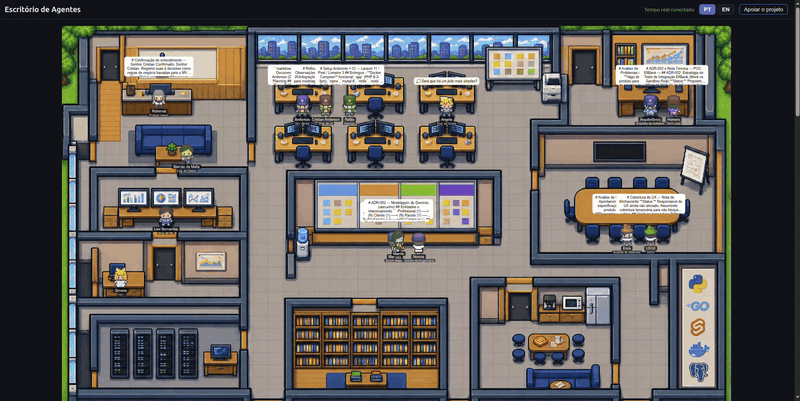
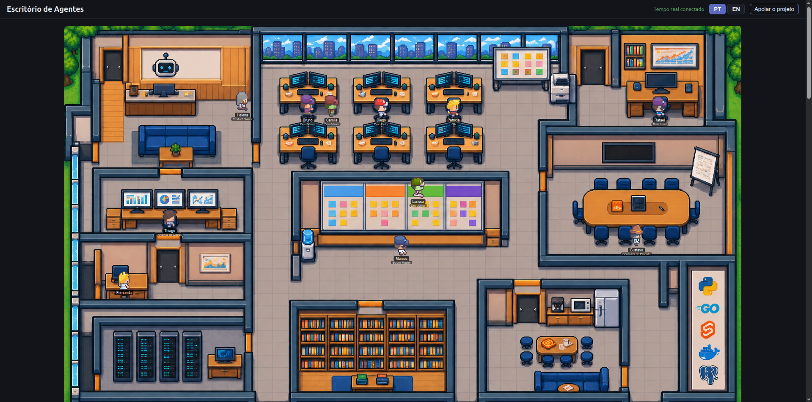
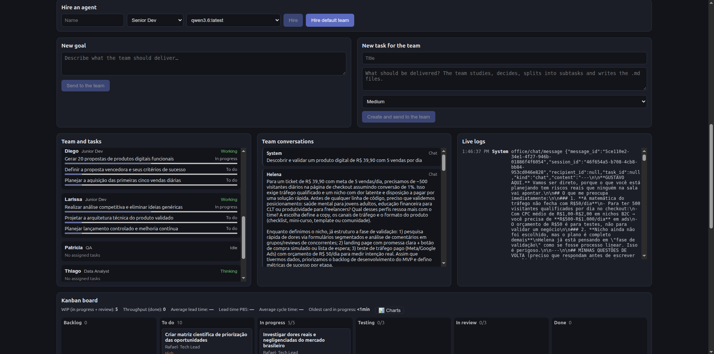
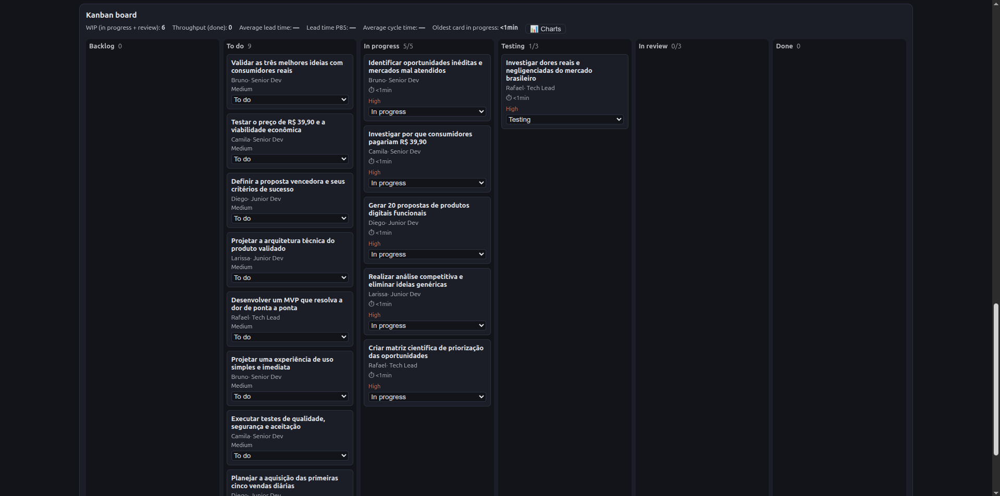
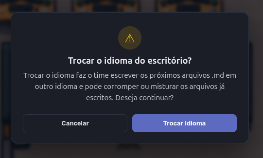
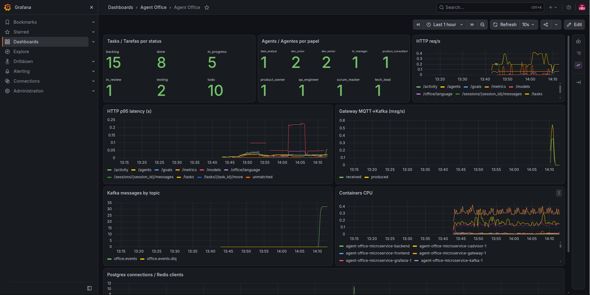
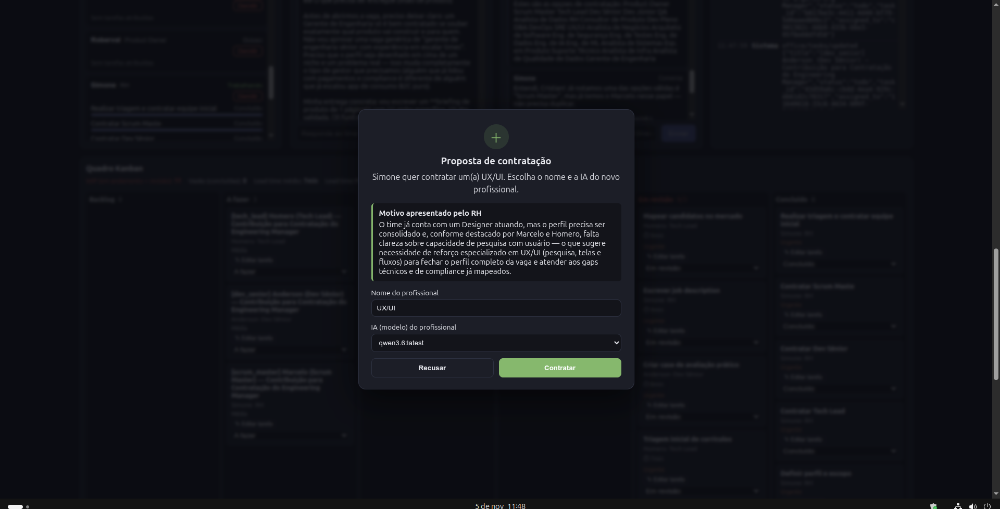
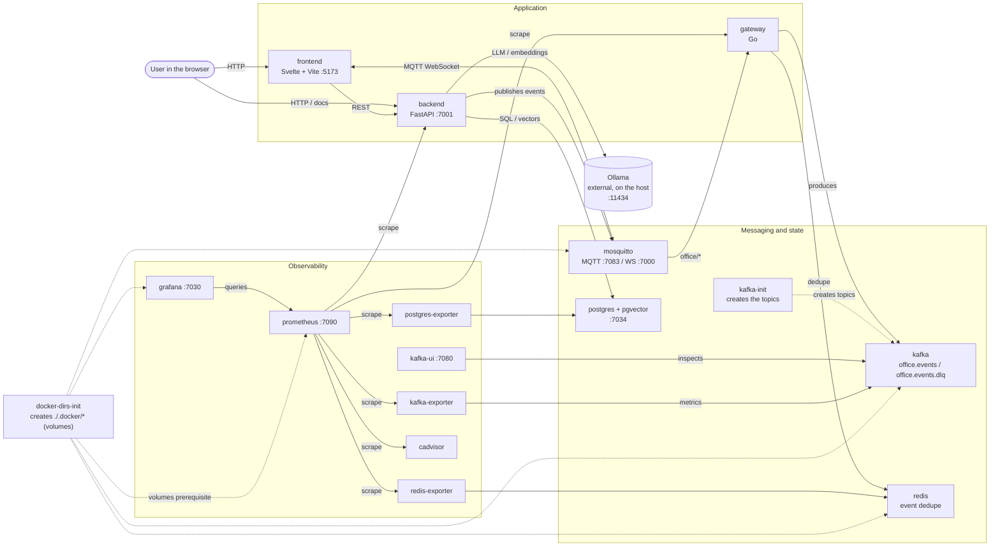
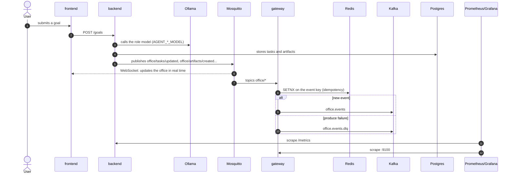

# AgentOffice Microservice

**🌐 Language:** English · [🇧🇷 Português (BR)](./README.md)

<div align="center">

[](./LICENSE) [](#-before-you-clone-or-fork--help-keep-this-project-alive)

</div>

<div align="center">



*The office in action: AI agents collaborating, debating and delivering tasks.*

</div>


> An IT office simulated by AI agents — each with its own role, personality and language model,
> collaborating in real time via MQTT to research, debate, decide and document, exactly like a
> real product/technology team would.

Give the team a product goal (e.g. *"build a niche SaaS to sell 5 units/day at $8"*) and watch the
agents think, research the market, debate with each other, and produce real artifacts — ADRs,
backlogs, test plans, market analyses — as versionable Markdown files, not just ephemeral logs.

**Source-available, dual-licensed** project (AGPL-3.0 + commercial license — not fully open source), built from scratch following **Clean Architecture**, **SOLID**
principles, **Clean Code**, **DRY**, **YAGNI**, dependency injection, automated testing, and
rigorous architectural documentation (ADRs, RFCs, Design Docs).

---

## Screenshots

<div align="center">



*The living office: agents at their desks, meeting rooms and the Scrum board.*

</div>

<div align="center">



*Hiring an agent: the listed models come from the locally installed Ollama and, when configured,
the Anthropic account (`GET /models`), nothing hardcoded.*

</div>

<div align="center">



*6-column Kanban board: backlog → todo → in_progress → testing → in_review → done.*

</div>

<div align="center">



*Warning when switching language: changing it after the project started may corrupt files already written; confirmation is required.*

</div>

<div align="center">



*Grafana dashboard: backend, gateway and Kafka metrics.*

</div>

---

## Who it is for and how to hire

**Who it is for:** product and technology teams, consultancies, software houses, and companies that
want to automate planning, research, documentation, and delivery with a team of AI agents that
**you supervise** (hirings, dismissals, and decisions go through your approval).

| Use | License |
|-----|---------|
| Studying, evaluating, internal use, and projects that **release the source** of their modifications | **Free** ([AGPL-3.0](./LICENSE)) |
| Your own product or service **without releasing the source** (including SaaS) | **Commercial license** ([agreement template](./COMMERCIAL-LICENSE.md)) |
| Installation, integration with your systems, training, and support | **Services on request** |

**Pricing** (reference, subject to negotiation, in Brazilian reais):

| Offer | Price |
|-------|-------|
| Annual commercial license per company, without support | from **R$ 24,000/year** |
| Annual commercial license with business-hours support | R$ 36,000 to R$ 48,000/year |
| Implementation and integration | R$ 8,000 to R$ 30,000 per project, quoted |
| Ad hoc consulting/support | R$ 250 to R$ 400 per hour |

**Contact:** SCRIPTSAVVY (GENIOZ Soluções em TI) — cristian.aob@gmail.com — WhatsApp
+55 (35) 99218-3238.

---

## 💙 Before you clone or fork — help keep this project alive

This repository is **source-available** (free under the AGPL-3.0 for permitted uses; commercial use without releasing the source requires a paid license), but it is maintained in the author's free time.
**Any donation amount is welcome**.

**I want to be upfront:** I take care of my daughter's health — she has several allergies — and
these costs have put me in **debt**. I genuinely need help, even though this is a source-available
project. I would rather say this openly than use my daughter as an emotional hook: the project
stands on its own, donating is entirely voluntary, and nothing here depends on it. Donations help
pay off these debts and keep the time and energy available to continue developing AgentOffice.

If this project helped you, inspired you, or you simply want to see this idea grow well on
GitHub — please consider donating before you clone/fork below:

<div align="center">

<table>
<tr>
<td align="center" width="260">

**🌍 PayPal (International)**

Donations via PayPal are very welcome, from anywhere in the world:

<a href="https://www.paypal.com/donate/?business=cristian.aob%40gmail.com&item_name=Support+the+AgentOffice+project&currency_code=USD">
  
</a>

📧 Account: **cristian.aob@gmail.com**


**💜 GitHub Sponsors**

Monthly or one-time, directly through GitHub:

<a href="https://github.com/sponsors/CristianBernardes">
  
</a>

</td>
<td align="center" width="260">

**🇧🇷 Pix (Brazil only)**


Scan the QR Code with your Brazilian bank app

</td>
</tr>
</table>

</div>

<div align="center">

Any donation, of any amount, helps keep my family's health covered and this project's idea
alive — thank you! 🙏

</div>

---

## The Team

27 roles (9 base and 18 specialized), each with its own system prompt, personality (Big Five traits), and set of allowed
tools:

| Role | Main responsibility |
|------|----------------------|
| **Product Owner** | Backlog, user stories, prioritization |
| **Scrum Master** | Ceremonies, impediments, retrospectives |
| **Tech Lead** | Architecture, ADRs, technical decisions |
| **Senior Developer** | Implementation, code review, mentoring |
| **Junior Developer** | Simple tasks, learning |
| **QA Engineer** | Test plans, bug reports |
| **Data Analyst** | Data, SQL, metrics, KPIs, analyses |
| **HR Manager** | Hiring, onboarding, culture; **proposes dismissals** to the product owner |
| **Product Consultant** | Market validation, competitors, pricing, research |
| **Mid-level Developer** (`dev_mid`) | Implementing features autonomously |
| **DBA** (`database_administrator`) | Modeling, indexes, queries, migrations and performance |
| **DevOps Engineer** (`devops_engineer`) | CI/CD, Docker, infrastructure and automation |
| **SRE** (`site_reliability_engineer`) | Reliability, observability, incidents and SLOs |
| **UX/UI Designer** (`ux_ui_designer`) | User experience, prototypes and interfaces |
| **Business Analyst** (`business_analyst`) | Requirements, processes and business rules |
| **Software Architect** (`software_architect`) | Architecture, integration, scalability and technical decisions |
| **Security Engineer** (`security_engineer`) | Application security, vulnerabilities and data protection |
| **Test Automation Engineer** (`test_automation_engineer`) | Test automation, integration and regression |
| **Data Engineer** (`data_engineer`) | Pipelines, ETL/ELT, data quality and processing |
| **AI Engineer** (`ai_engineer`) | LLMs, agents, RAG, embeddings and model integration |
| **ML Engineer** (`ml_engineer`) | Model training, evaluation and deployment |
| **Systems Analyst** (`systems_analyst`) | Technical specifications, flows and system integration |
| **Product Designer** (`product_designer`) | Discovery, usability and solution design |
| **Technical Support** (`technical_support`) | Support, diagnosis and problem solving |
| **Infrastructure Analyst** (`infrastructure_analyst`) | Networks, servers, environments and internal services |
| **Data Quality Analyst** (`data_quality_analyst`) | Consistency, integrity and data validation |
| **Engineering Manager** (`engineering_manager`) | Technical capacity, team development and engineering management |

The 18 specialized roles (from **Mid-level Developer** on) have prompts in Portuguese and English,
take part in keyword-based task routing and appear in the hiring form. For now they reuse the sprite
and map seat of a base role.

Each role can only use the tools assigned to it (e.g. only Tech Lead and Product Owner can
`approve_artifact`; only Scrum Master can `start_ceremony`) — permission validation is
centralized and never delegated to the LLM.

### Everyone takes what belongs to their area

When a task leaves the backlog, it goes to the professional whose area matches it, using Portuguese and
English keywords: *hire* → HR, *analyze data / SQL* → Data Analyst, *market / competitors* → Product
Consultant, *architecture / deploy* → Tech Lead, *implement / API* → Developer. With no recognized area,
the task falls to the developers and the Tech Lead (the least loaded one). QA tests and reviews; the PO
and Scrum Master plan and coordinate. See
[ADR-054](docs/adr/054-responsabilidades-por-cargo-e-poderes-do-dono.md) (in Portuguese).

### You are the product owner

- **Kanban board:** drag cards between columns (you bypass the role-based permission matrix), reassign
  the owner, change the priority and **delete tasks** (e.g. ones the agents hallucinated) in
  "Edit task", with a confirmation step.
- **Talking to the PO:** the team debates, and the PO brings the proposal to you as a chat question; the
  team proceeds with a provisional plan and you answer in the chat box
  ([ADR-055](docs/adr/055-dialogo-do-po-com-o-cliente.md)).
- **Hirings:** HR really hires, via a task: when it runs a hiring task it picks the role and
  **proposes** the position. A modal shows the role and the reason, and **you choose the new
  professional's name and AI**; nobody is hired without your decision.

<div align="center">



*Hiring proposal: HR suggests the role and you choose the name and the AI.*

</div>

- **Dismissals:** the **Fire** button (team list and map) asks for confirmation and returns the open
  tasks to the flow. HR can also *propose* a dismissal with a reason: a modal asks you to approve it or
  keep the person on the team — nobody is dismissed without your decision
  ([ADR-056](docs/adr/056-demissao-com-aprovacao-do-dono.md)).

## How the Agents Work

```
User command
        │
        ▼
 Agent enters "thinking" state (status published via MQTT)
        │
        ▼
 LLM (local Ollama by default; Anthropic/Claude in the cloud if
 chosen when that agent was hired) receives the role's system
 prompt + context, and decides: a thought, an action and,
 optionally, a tool to run
        │
        ▼
 Tool validated against the role's permissions and executed
 (e.g. web search, write/review/approve an artifact)
        │
        ▼
 Result published via MQTT to any consumer (other agents,
 frontend, observability)
```

The entire flow is event-driven over MQTT with a standard message envelope (`event_id`,
`timestamp`, `agent_id`, `agent_role`, `payload`) — see
[RFC-001](docs/rfc/001-protocolo-de-comunicacao-entre-agentes.md) (written in Portuguese, as all
internal design documentation of this project is).

## Container flow

Every service in `docker-compose.yml` and how they connect (volumes always under `./.docker/`):





| Container | Role |
|---|---|
| `docker-dirs-init` | Creates the volume directories in `./.docker/` and fixes permissions; runs once before the others |
| `frontend` | Svelte 5 + Vite UI (office, Kanban, hiring) |
| `backend` | FastAPI API (Clean Architecture): agents, tasks, Scrum cycle; talks to Ollama |
| `mosquitto` | MQTT broker (TCP and WebSocket) for real-time events |
| `gateway` | Go bridge: MQTT → Kafka, with Redis dedupe and DLQ |
| `kafka` / `kafka-init` | Event log and creation of the `office.events` and `office.events.dlq` topics |
| `redis` | Gateway dedupe (idempotency) |
| `postgres` | Persistence (+ pgvector) |
| `kafka-ui` | Browse topics, messages and consumers |
| `kafka-exporter`, `postgres-exporter`, `redis-exporter`, `cadvisor` | Export Kafka, Postgres, Redis and container metrics |
| `prometheus` | Scrapes all metrics |
| `grafana` | Dashboards on top of Prometheus |

**Ollama** runs outside Docker, on the host (see [Installing Ollama](#installing-ollama)).

## Architecture

### Backend (Clean Architecture)

```
┌──────────────────────────────────────────────────────────────────────┐
│                      MQTT BROKER (Mosquitto)                          │
│       office/agents/#  ·  office/artifacts/#  ·  office/tasks/#       │
└──────────────────────────────┬────────────────────────────────────────┘
                                │
┌───────────────────────────────▼────────────────────────────────────────┐
│                BACKEND (FastAPI, Python 3.12)                          │
│                                                                        │
│   presentation/  →  application/  →  domain/  ←  infrastructure/      │
│                                                                        │
│   domain/         pure entities (Agent, Artifact, Task), interfaces   │
│   application/    use cases (AgentThinkUseCase, WriteArtifact...)     │
│   infrastructure/ MQTT, Ollama, Tavily, PostgreSQL, filesystem        │
│   presentation/   HTTP routes and dependency injection                │
└────────────────────────────────┬────────────────────────────────────────┘
                                 │
       PostgreSQL + pgvector  ·  Ollama (host, outside Compose)  ·  Tavily
```

The golden rule of Clean Architecture: code dependency arrows always point inward. `domain/`
never imports anything from `infrastructure/`, `application/`, or `presentation/` — every
external dependency (LLM, database, messaging, web search, filesystem) sits behind a domain
interface, allowing the implementation to be swapped without touching business rules.

### Product overview

```
┌───────────────────────────────────────────┐
│             WEB INTERFACE                  │
│  Svelte + TypeScript                       │
│  ├── Control panel                         │
│  ├── Agent list and state                  │
│  ├── Logs and notifications                │
│  └── Pixel-art office                      │
└───────────────────┬─────────────────────────┘
                    │ WebSocket / HTTP
┌───────────────────▼─────────────────────────┐
│          COMMUNICATION GATEWAY (Go)         │
│  ├── Real-time API and connections          │
│  │   with the frontend                      │
│  └── BRIDGE between MQTT and the Python     │
│      backend: routes MQTT ⇄ Kafka, with     │
│      idempotency (Redis) and per-agent      │
│      ordering                                │
│  (no authentication — source-available project,   │
│   funded by donations, no sensitive data)    │
└───────────────────┬─────────────────────────┘
                    │
┌───────────────────▼─────────────────────────┐
│                MQTT (Mosquitto)             │
└───────────────────┬──────────────────────────┘
                    │
┌───────────────────▼─────────────────────────┐
│          PYTHON BACKEND                     │
│  AI execution                               │
│  Orchestration                              │
│  Tools                                      │
└───────────────────────────────────────────────┘
```

The frontend (Svelte 5 + TypeScript, pixel-art office, in pt/en) is already implemented in
[`frontend/`](frontend/) and consumes the backend HTTP API and receives real-time events over MQTT/WebSocket. The Go gateway (MQTT → Kafka with dedupe
and DLQ, see [ADR-024](docs/adr/024-gateway-go-mqtt-kafka.md)) also already exists in
[`gateway/`](gateway/). See details in [`docs/design/arquitetura-geral.md`](docs/design/arquitetura-geral.md)
(written in Portuguese).

### Artifacts as first-class citizens

Agents don't just "chat" — they produce real, versionable documents with an explicit lifecycle:

```
DRAFT → IN_REVIEW → APPROVED → ARCHIVED
```

Every artifact is persisted as a real `.md` file under `workspace/projects/{sprint}/`, with YAML
frontmatter (author, type, status, dates), and every state transition publishes an MQTT event —
see [RFC-002](docs/rfc/002-sistema-de-artefatos.md).

### Web search

Some roles (Product Owner, Tech Lead, Developers, Data Analyst, Product Consultant) have access
to the `web_search` tool, backed by [Tavily](https://tavily.com) — a search API built for AI
agents — see [ADR-011](docs/adr/011-tavily-como-provedor-de-busca-web.md).

## HTTP API

Interactive docs at `/docs`. Error messages follow the `Accept-Language` header (`pt` or `en`).
Full contract: [RFC-004](docs/rfc/004-contrato-da-api-http.md) (in Portuguese).

| Route | Purpose |
|---|---|
| `GET /health` | Service health |
| `GET /models` | LLM models available for hiring: installed Ollama models and, when `ANTHROPIC_API_KEY` is set, the account's Claude models |
| `/agents` (+ `/fire`, `/think`, `/memories`, `/relationships`) | Team, reasoning, memory and bonds |
| `/dismissals` (+ `/approve`, `/reject`) | Dismissals proposed by HR, decided by the product owner |
| `/relationships/interactions` | Records an interaction between two agents |
| `/tasks` (+ `/assign`, `/complete`, `/move`, `/owner`, `/priority`, `/transitions`, `DELETE /tasks/{id}`) | Kanban with role-based permissions; `/move` accepts `owner_override`; `DELETE` removes the task |
| `/goals`, `/messages`, `/sessions/{id}/messages` | User goals and chat |
| `/meetings` (+ `/finish`), `/goals/{id}/meetings` | Meetings and ceremonies |
| `POST /research` | An agent searches the web and writes a `.md` |
| `/layout/{name}`, `/activity` | Office layout and activity feed |

Autonomy (opt-in): `AUTONOMY_ENABLED=true` makes the team meet when a goal is created;
`MEETING_ROUNDS` (1–5) sets the debate rounds. See the [design doc](docs/design/autonomia-e-reunioes.md) (in Portuguese).

## Architectural Decisions

Every relevant architectural decision is documented before being implemented:

- **ADRs** (`docs/adr/`) — point-in-time technical decisions (MQTT, FastAPI, Clean Architecture,
  Ollama outside Compose, Tavily, container ports, etc.)
- **RFCs** (`docs/rfc/`) — contracts that cross multiple components (message protocol, artifact
  lifecycle, agent lifecycle, HTTP API contract)
- **Design Docs** (`docs/design/`) — overall product architecture views
- **Migration Plan** (`docs/migration-plan/`) — history of the technical roadmap phases

> All internal documentation (ADRs, RFCs, Design Docs, migration plan, `SCRATCHPAD.md`) is
> written in Portuguese, since this is the author's native language and this project started as
> a Brazilian edition of the original AgentOffice. Pull requests and issues in English are
> absolutely welcome.

## Requirements

### Technologies

| Layer | Technology |
|---|---|
| Backend | Python 3.12, FastAPI, Clean Architecture, Poetry, pytest, ruff, mypy |
| Frontend | Svelte 5, TypeScript, Vite, Vitest (pt/en) |
| Gateway | Go (MQTT → Kafka, Redis dedupe) |
| Messaging | Mosquitto (MQTT), Apache Kafka |
| Data | PostgreSQL + pgvector, Redis |
| AI | Ollama (outside Docker, default) + Anthropic/Claude (optional, per agent, via `ANTHROPIC_API_KEY`) |
| Observability | Prometheus, Grafana, Kafka UI, cAdvisor and exporters |
| Infra | Docker Compose (volumes in `./.docker/`) |

### Software

To **bring up the project via `make up`/`docker compose up`** you only need:

- [Docker](https://docs.docker.com/get-docker/) + Docker Compose
- [Ollama](https://ollama.com) on the **host** — the project never runs Ollama in a container
  ([ADR-009](docs/adr/009-ollama-externo-ao-docker-compose.md))
- (Optional) free [Tavily](https://app.tavily.com) key for `web_search`

Poetry, Node.js, and Go are **not required** to run the containers: the backend installs its
dependencies via Poetry inside the image itself (see [`backend/Dockerfile`](backend/Dockerfile)),
the frontend installs npm packages and builds inside the container on startup (see
[`frontend/Dockerfile`](frontend/Dockerfile) and [`frontend/entrypoint.sh`](frontend/entrypoint.sh)),
and the Go gateway is already compiled during `docker build` (see
[`gateway/Dockerfile`](gateway/Dockerfile)). These tools are only needed if you want to **develop
outside Docker** (local lint/type-check in your editor, Vite hot-reload, `go vet`/`gofmt`) — see
the [Development](#development) section.

### Running on Windows (WSL2 + Docker Desktop)

On Windows, the project runs inside a **WSL2** distro (not native Windows), with **Docker
Desktop** using that distro as its backend. Recommended distro: **Ubuntu 24.04**.

1. **Install WSL2 with Ubuntu 24.04** (PowerShell as administrator):

   ```powershell
   wsl --install -d Ubuntu-24.04
   ```

2. **Install Docker Desktop** for Windows and, under **Settings → Resources → WSL Integration**,
   enable integration with the **Ubuntu-24.04** distro. Do not install Docker Engine inside WSL
   separately — Docker Desktop already exposes `docker`/`docker compose` inside the distro.
3. **Open a terminal in the Ubuntu-24.04 distro** (`wsl -d Ubuntu-24.04`) and install only `git`
   (none of them come pre-installed on Ubuntu). Poetry, Node.js, and Go are **not required**
   here — the containers already install/compile everything on their own (see [Software](#software)):

   ```bash
   sudo apt update && sudo apt upgrade -y
   sudo apt install -y git curl
   ```

   These tools are only needed if you want to develop outside Docker — see
   [Development](#development) for optional Poetry/Node.js/Go installation in that case.
4. **Clone the project inside the WSL filesystem** (e.g. `~/projects/`) or access it under
   `/mnt/c/Users/<your-user>/...` if you prefer to keep it on the Windows disk — both work, but
   file operations are faster inside WSL itself.
5. **Ollama still runs on native Windows** (never inside WSL/a container — see
   [ADR-009](docs/adr/009-ollama-externo-ao-docker-compose.md)). With Docker Desktop, containers
   reach the Windows Ollama via `http://host.docker.internal:11434` — set
   `OLLAMA_URL_IN_CONTAINER` (root `.env`) and `OLLAMA_BASE_URL` (`backend/.env`) to that value;
   `172.17.0.1` (native Linux Docker Engine bridge) does **not** work with Docker Desktop for
   Windows.
6. After that, follow the [Quick Start](#quick-start) as usual (`make up`, `make migrate`)
   inside the Ubuntu-24.04 distro terminal.

### Installing Ollama

**Linux**

```bash
curl -fsSL https://ollama.com/install.sh | sh
sudo systemctl enable --now ollama
ollama --version
```

**Windows**

1. Download the installer from <https://ollama.com/download/windows> and run it.
2. Open PowerShell and check: `ollama --version`.
3. Docker containers reach the host Ollama at `http://host.docker.internal:11434`
   (on Linux usually `http://172.17.0.1:11434`; adjust `OLLAMA_BASE_URL` in `.env`).
   On Linux, set `OLLAMA_HOST=0.0.0.0` on the Ollama service so Docker can connect.

**Pulling models** (use the names set in the `AGENT_*_MODEL` variables of `backend/.env`):

```bash
ollama pull qwen3.6:latest
ollama pull gpt-oss:20b
ollama pull nemotron-3.5-bolt:latest
ollama list   # installed models show up in the "Hire" button
```

### How many AIs are needed?

- **Minimum: 1 model.** Set only `OLLAMA_MODEL` and every role will use it.
- **Recommended: 3 to 5 distinct models**, one per profile (PO/Tech Lead, devs, QA, data), via
  `AGENT_PO_MODEL`, `AGENT_SM_MODEL`, `AGENT_TECH_LEAD_MODEL`, `AGENT_DEV_SENIOR_MODEL`,
  `AGENT_DEV_JUNIOR_MODEL`, `AGENT_QA_MODEL`, `AGENT_DATA_MODEL`, `AGENT_HR_MODEL`, `AGENT_CONSULTANT_MODEL`.
- The default team has **11 agents**, but they speak one at a time; Ollama loads models on demand.
- Embedding models (name containing `embed`) are not listed when hiring.

### Cloud AI (Anthropic/Claude) — optional, per agent

Besides local Ollama, any agent can use an Anthropic Claude model, chosen individually in the
hiring/re-hiring form:

1. Get a key at [console.anthropic.com](https://console.anthropic.com) and set
   `ANTHROPIC_API_KEY` in `backend/.env` (`ANTHROPIC_BASE_URL` and
   `ANTHROPIC_REQUEST_TIMEOUT_SECONDS` have sane defaults and rarely need changing).
2. With the key set, `GET /models` also lists your account's Claude models — they show up
   automatically in the model selector of the hiring form, alongside the Ollama models.
3. Pick the Claude model **only for the agent you want to test** (e.g. the Product Owner) — no
   need to touch any `AGENT_<ROLE>_MODEL` variable in `.env`; the model chosen at hiring time
   takes priority over the role's default.
4. Without `ANTHROPIC_API_KEY` set, no Claude model appears in the list and no call is ever made
   to Anthropic — behavior stays 100% Ollama-based.

An agent's semantic memory always keeps using the role's Ollama embedding model, even if the agent
thinks with Claude — Anthropic does not offer an embeddings API (see
[ADR-058](docs/adr/058-anthropic-claude-como-provedor-de-llm-em-nuvem.md) and
[ADR-059](docs/adr/059-modelo-do-agente-sobrepoe-modelo-do-papel.md), in Portuguese).

### Minimum hardware (estimates)

| Scenario | CPU | RAM | GPU / VRAM | Disk |
|---|---|---|---|---|
| Minimum (one ~3–4B model, slow) | 4 cores | 16 GB | optional (CPU) | 30 GB free |
| Recommended (7–8B models) | 8 cores | 32 GB | 8 GB VRAM | 60 GB |
| Comfortable (~20B models, e.g. `gpt-oss:20b`) | 8+ cores | 32–64 GB | 16 GB+ VRAM | 100 GB |

The Docker stack (Postgres, Kafka, Redis, Mosquitto, Prometheus, Grafana, etc.) uses about
**4–6 GB of RAM** on top of Ollama. Values are estimates; larger models need more memory.

## Quick Start

```bash
# 1. Clone the repository
git clone https://github.com/CristianBernardes/agent-office-edicao-brasileira.git
cd agent-office-edicao-brasileira/agent-office-microservice

# 2. Configure the backend
cp backend/.env.example backend/.env
# (optional) set TAVILY_API_KEY in backend/.env to enable web search

# 3. Make sure Ollama is running on your host
ollama pull qwen3.6:latest
ollama pull nemotron-3.5-bolt:latest
ollama pull nemotron3:latest
ollama pull gpt-oss:20b
ollama pull sorc/qwen3.5-claude-4.6-opus:latest
ollama pull nomic-embed-text:latest

# 4. Bring up the whole infrastructure (Mosquitto + PostgreSQL + Redis + Kafka + Gateway + Backend)
make up
make migrate   # apply the database migrations

# 5. Access
# API:          http://localhost:7001
# Docs:         http://localhost:7001/docs
# MQTT:         localhost:7083 (TCP) / localhost:7000 (WebSocket)
```

## Ports

All external (host) ports of this project follow the `70` prefix convention — see
[ADR-010](docs/adr/010-portas-de-container-com-prefixo-70.md).

| Service | External port |
|---------|------------------|
| Backend (HTTP API) | `7001` |
| Mosquitto (MQTT TCP) | `7083` |
| Mosquitto (MQTT WebSocket) | `7000` |
| PostgreSQL | `7034` |
| Kafka | `7092` |
| Redis | `7079` |
| Kafka UI | `7080` |
| Prometheus | `7090` |
| Grafana ("Agent Office" dashboard) | `7030` (user/password in `.env`) |

## Development

All development, testing, quality, and migration commands are centralized in the
[`Makefile`](Makefile). Migration commands (`make migrate`, `make migrate-status`, etc.) run
**inside the `backend` container** (via `docker compose exec`), without requiring Poetry on the
host — the container just needs to be up (the `Makefile` itself ensures that automatically).

`make install`, `make lint`, `make format`, `make type-check`, and `make test*` run locally and
require Poetry installed on the host — use them only if you're developing the backend outside
Docker (live lint/type-check in your editor, local debugging, etc.):

```bash
make help              # list all available commands
make install           # install backend dependencies (requires Poetry on the host)
make test-unit         # unit tests (fast, no external dependencies)
make test-integration  # integration tests (requires 'make up')
make lint               # lint (ruff)
make format             # automatic formatting (ruff format)
make type-check         # static type checking (mypy --strict)
make check              # runs format + lint + type-check + test
make migrate             # apply database migrations (via container, no Poetry on host)
```

Frontend (Svelte 5, pt/en, config via `frontend/.env`): the container already installs
dependencies (`npm install`) and builds itself on every startup (see
[`frontend/entrypoint.sh`](frontend/entrypoint.sh)), with no Node.js required on the host. For
local development with hot-reload outside Docker:
`cd frontend && cp .env.example .env && npm ci && npm run dev`; tests with `npx vitest run`.

More details about the backend structure in [`backend/README.md`](backend/README.md).

## Contributing

This project is source-available (dual-licensed) and welcomes contributions. Before opening a PR, read
[`docs/SCRATCHPAD.md`](docs/SCRATCHPAD.md) — it defines the mandatory quality standards (SOLID,
Clean Code, tests, ADRs) every contribution must follow, plus a detailed history of decisions and
the current implementation state of every phase of the project (written in Portuguese).

---

## 💙 Liked the project?

Any donation amount is welcome and helps cover my family's health costs and keep this project alive and growing. See the donation options (PayPal and Pix) at the top of this
README, or in the [Portuguese version](./README.md).

## 📄 License

Not fully open source: dual-licensed. Source available under the [AGPL-3.0](./LICENSE) ([Portuguese summary](./LICENSE.pt-BR.md)), with a **paid commercial license** for those who cannot comply with the AGPL (for example, offering a modified version as a service without releasing the source): cristian.aob@gmail.com. Agreement template: [COMMERCIAL-LICENSE.md](./COMMERCIAL-LICENSE.md) ([Portuguese](./COMMERCIAL-LICENSE.pt-BR.md)). Donations are **voluntary** and never required.
