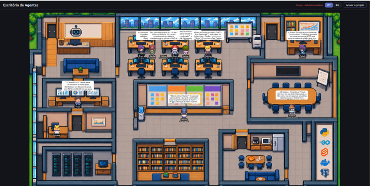
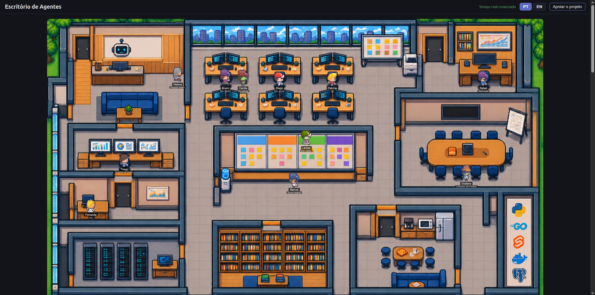
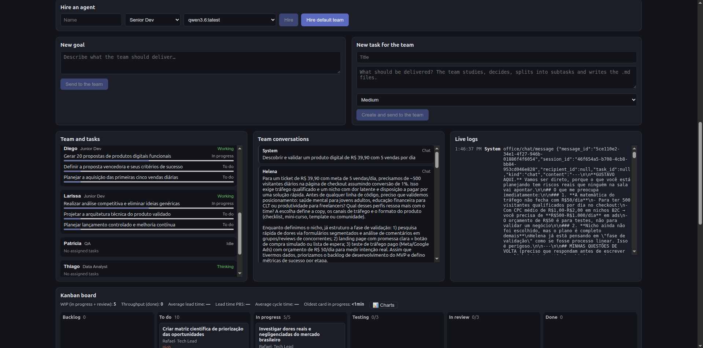
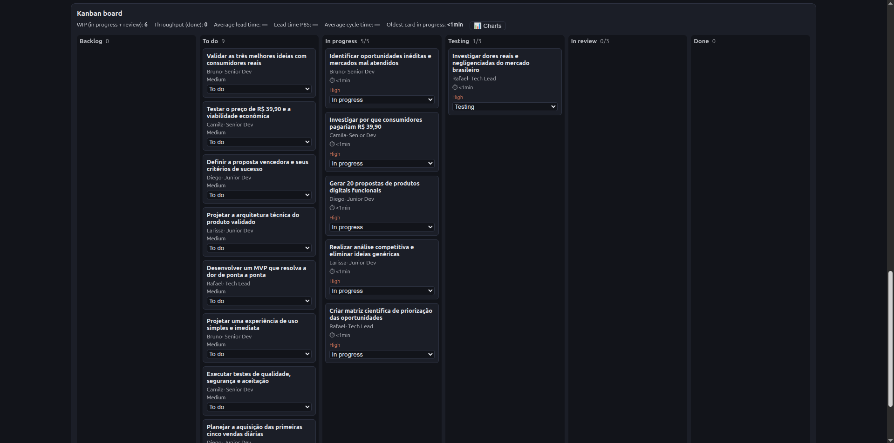
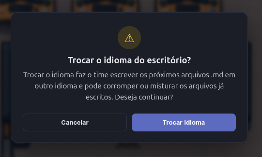
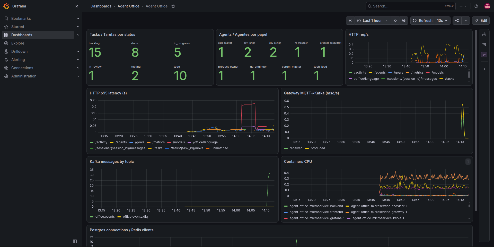
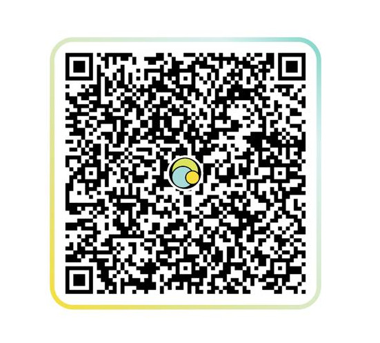
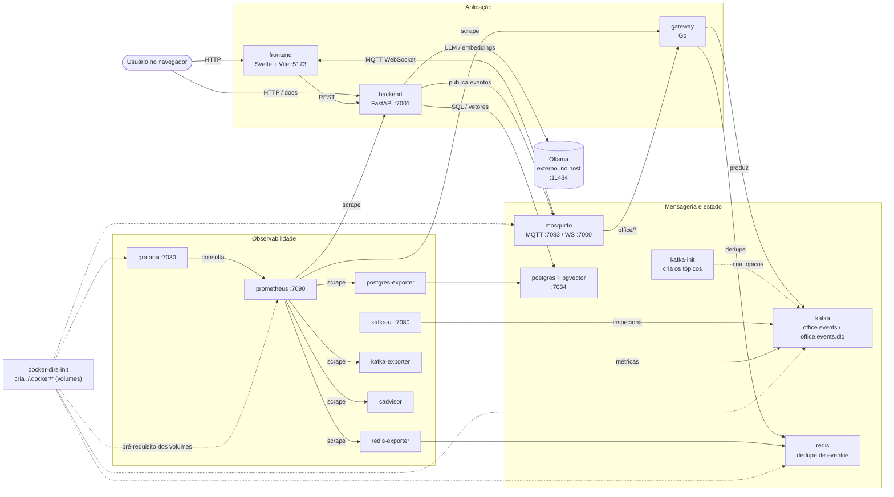
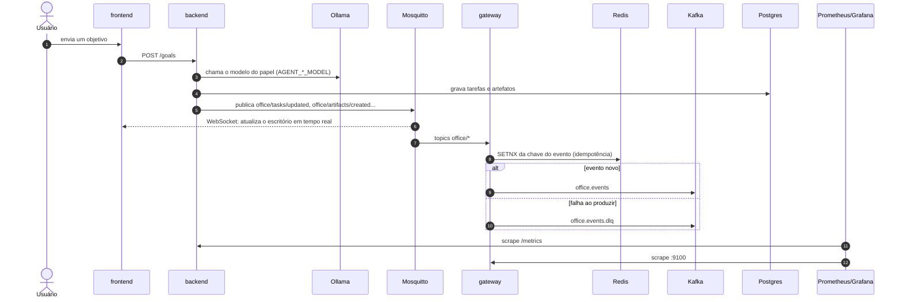

# AgentOffice Microservice

**🌐 Idioma:** Português (BR) · [🇺🇸 English](./README.en.md)

[](https://github.com/CristianBernardes/agent-office-microservice/actions/workflows/ci.yml)
[](./LICENSE) [](#-antes-de-clonar-ou-fazer-fork--ajude-a-manter-este-projeto-vivo)

▶️ **Assista ao vídeo de demonstração:**

[](https://youtu.be/sAiGLPTWMv4)


> Um escritório de TI simulado por agentes de IA — cada um com um papel, personalidade e modelo de
> linguagem próprios, colaborando em tempo real via MQTT para pesquisar, debater, decidir e
> documentar, exatamente como um time humano de produto/tecnologia faria.

Dê ao time um objetivo de produto (ex.: *"criem um SaaS de nicho para vender 5 unidades/dia a
R$39,90"*) e observe os agentes pensarem, pesquisarem o mercado, debaterem entre si e produzirem
artefatos reais — ADRs, backlogs, planos de teste, análises de mercado — em arquivos Markdown
versionáveis, não apenas em logs efêmeros.

Projeto **open source**, construído do zero seguindo **Clean Architecture**, princípios **SOLID**,
**Clean Code**, **DRY**, **YAGNI**, injeção de dependência, testes automatizados e documentação
arquitetural rigorosa (ADRs, RFCs, Design Docs).

---

## Capturas de tela



*O escritório vivo: agentes em suas mesas, salas de reunião e quadro Scrum.*



*Contratação de agente: os modelos listados vêm do Ollama instalado (`GET /models`), nada fixo no código.*



*Quadro Kanban de 6 colunas: backlog → todo → in_progress → testing → in_review → done.*



*Aviso ao trocar o idioma: alterar depois do projeto iniciado pode corromper arquivos já escritos; é preciso confirmar.*



*Painel do Grafana com métricas do backend, gateway e Kafka.*

---

## 💙 Antes de clonar ou fazer fork — ajude a manter este projeto vivo

Este repositório é **open source e gratuito**, mas é mantido no tempo livre do autor. **Qualquer
valor de doação é bem-vindo**.

**Quero ser transparente:** cuido da saúde da minha filha, que tem várias alergias, e acabei me
**endividando** por causa desses custos. Preciso de ajuda de verdade, mesmo sendo um projeto open
source. Prefiro dizer isso abertamente a usar minha filha como gatilho emocional: o projeto vale
por si só, a doação é totalmente voluntária e nada aqui depende dela. As doações ajudam a quitar
essas dívidas e a manter tempo e energia para continuar desenvolvendo o AgentOffice.

Se este projeto te ajudou, te inspirou, ou você simplesmente quer ver essa ideia crescer bem no
GitHub — considere doar antes de seguir para o clone/fork abaixo:

<div align="center">

<table>
<tr>
<td align="center" width="260">

**🇧🇷 Pix (Brasil)**



Escaneie o QR Code com o app do seu banco

</td>
<td align="center" width="260">

**🌍 PayPal (Internacional)**

Para quem está fora do Brasil, doações via PayPal são muito bem-vindas:

<a href="https://www.paypal.com/donate/?business=cristian.aob%40gmail.com&item_name=Support+the+AgentOffice+project&currency_code=USD">
  
</a>

📧 Conta: **cristian.aob@gmail.com**


**💜 GitHub Sponsors**

Recorrente ou único, direto pelo GitHub:

<a href="https://github.com/sponsors/CristianBernardes">
  
</a>

</td>
</tr>
</table>

</div>

<div align="center">

Toda doação, de qualquer valor, ajuda a manter a saúde da minha família e a ideia deste projeto
viva — obrigado! 🙏

</div>

---

## O Time

Nove papéis, cada um com um system prompt próprio, personalidade (Big Five) e conjunto de
ferramentas permitidas:

| Papel | Responsabilidade principal |
|-------|------------------------------|
| **Product Owner** | Backlog, user stories, priorização |
| **Scrum Master** | Cerimônias, impedimentos, retrospectivas |
| **Tech Lead** | Arquitetura, ADRs, decisões técnicas |
| **Dev Sênior** | Implementação, code review, mentoria |
| **Dev Júnior** | Tarefas simples, aprendizado |
| **QA Engineer** | Planos de teste, bug reports |
| **Analista de Dados** | Métricas, KPIs, análises |
| **Gerente de RH** | Onboarding, cultura, contratações |
| **Consultor de Produto** | Validação de mercado, pesquisa |

Cada papel só pode usar as ferramentas que lhe foram atribuídas (ex.: só Tech Lead e Product Owner
podem `approve_artifact`; só Scrum Master pode `start_ceremony`) — a validação de permissão é
centralizada e nunca delegada ao LLM.

## Como os Agentes Trabalham

```
Comando do usuário
        │
        ▼
 Agente entra em "pensamento" (status publicado via MQTT)
        │
        ▼
 LLM (Ollama local, ou qualquer API OpenAI-compatible) recebe o
 system prompt do papel + contexto, e decide: pensamento, ação e,
 opcionalmente, uma ferramenta a executar
        │
        ▼
 Ferramenta validada contra as permissões do papel e executada
 (ex.: pesquisar na web, escrever/revisar/aprovar um artefato)
        │
        ▼
 Resultado publicado via MQTT para qualquer consumidor (outros
 agentes, frontend, observabilidade)
```

Todo o fluxo é orientado a eventos MQTT com um envelope de mensagem padrão (`event_id`, `timestamp`,
`agent_id`, `agent_role`, `payload`) — ver
[RFC-001](docs/rfc/001-protocolo-de-comunicacao-entre-agentes.md).

## Fluxo dos containers

Todos os serviços do `docker-compose.yml` e como se conectam (volumes sempre em `./.docker/`):





| Container | Função |
|---|---|
| `docker-dirs-init` | Cria os diretórios de volume em `./.docker/` e ajusta permissões; roda uma vez antes dos demais |
| `frontend` | Interface Svelte 5 + Vite (escritório, Kanban, contratação) |
| `backend` | API FastAPI (Clean Architecture): agentes, tarefas, ciclo Scrum; fala com o Ollama |
| `mosquitto` | Broker MQTT (TCP e WebSocket) para eventos em tempo real |
| `gateway` | Ponte Go: MQTT → Kafka, com dedupe no Redis e DLQ |
| `kafka` / `kafka-init` | Log de eventos e criação dos tópicos `office.events` e `office.events.dlq` |
| `redis` | Dedupe (idempotência) do gateway |
| `postgres` | Persistência (+ pgvector) |
| `kafka-ui` | Acompanhar tópicos, mensagens e consumidores |
| `kafka-exporter`, `postgres-exporter`, `redis-exporter`, `cadvisor` | Exportam métricas de Kafka, Postgres, Redis e dos containers |
| `prometheus` | Coleta (scrape) de todas as métricas |
| `grafana` | Dashboards sobre o Prometheus |

O **Ollama** roda fora do Docker, no host (ver [Instalando o Ollama](#instalando-o-ollama)).

## Arquitetura

### Backend (Clean Architecture)

```
┌──────────────────────────────────────────────────────────────────────┐
│                      MQTT BROKER (Mosquitto)                          │
│       office/agents/#  ·  office/artifacts/#  ·  office/tasks/#       │
└──────────────────────────────┬────────────────────────────────────────┘
                                │
┌───────────────────────────────▼────────────────────────────────────────┐
│                BACKEND (FastAPI, Python 3.12)                          │
│                                                                        │
│   presentation/  →  application/  →  domain/  ←  infrastructure/      │
│                                                                        │
│   domain/         entidades puras (Agent, Artifact, Task), interfaces │
│   application/    casos de uso (AgentThinkUseCase, WriteArtifact...)  │
│   infrastructure/ MQTT, Ollama, Tavily, PostgreSQL, filesystem        │
│   presentation/   rotas HTTP e injeção de dependência                 │
└────────────────────────────────┬────────────────────────────────────────┘
                                 │
       PostgreSQL + pgvector  ·  Ollama (host, fora do Compose)  ·  Tavily
```

A regra de ouro do Clean Architecture: as setas de dependência de código sempre apontam para
dentro. O `domain/` nunca importa nada de `infrastructure/`, `application/` ou `presentation/` —
toda dependência externa (LLM, banco, mensageria, busca web, filesystem) fica atrás de uma
interface de domínio, permitindo troca de implementação sem alterar regra de negócio.

### Visão completa do produto (estado final planejado)

```
┌───────────────────────────────────────────┐
│             INTERFACE WEB                  │
│  Svelte + TypeScript                       │
│  ├── Painel de controle                    │
│  ├── Lista e estado dos agentes            │
│  ├── Logs e notificações                   │
│  └── Phaser: escritório em Pixel Art       │
└───────────────────┬─────────────────────────┘
                    │ WebSocket / HTTP
┌───────────────────▼─────────────────────────┐
│          GATEWAY DE COMUNICAÇÃO (Go)        │
│  ├── API e conexões em tempo real           │
│  │   com o frontend                         │
│  └── PONTE entre MQTT e o Backend Python:   │
│      roteia MQTT ⇄ Kafka, com idempotência  │
│      (Redis) e ordenação por agente         │
│  (sem autenticação — projeto open source,    │
│   mantido por doações, sem dados sensíveis)  │
└───────────────────┬─────────────────────────┘
                    │
┌───────────────────▼─────────────────────────┐
│                MQTT (Mosquitto)             │
└───────────────────┬──────────────────────────┘
                    │
┌───────────────────▼─────────────────────────┐
│          BACKEND PYTHON                     │
│  Execução de IA                             │
│  Orquestração                               │
│  Ferramentas                                │
└───────────────────────────────────────────────┘
```

O frontend (Svelte + Phaser.js, pixel-art) faz parte da visão completa do produto e ainda não foi
implementado neste repositório. O gateway Go (MQTT → Kafka com dedupe e DLQ, ver
[ADR-024](docs/adr/024-gateway-go-mqtt-kafka.md)) já existe em [`gateway/`](gateway/); servir o
frontend em tempo real ainda é pendente. Ver detalhes em [`docs/design/arquitetura-geral.md`](docs/design/arquitetura-geral.md)
e no plano de migração em [`docs/migration-plan/fase-8-microservicos/`](docs/migration-plan/fase-8-microservicos/README.md).

### Artefatos como cidadãos de primeira classe

Agentes não apenas "conversam" — eles produzem documentos reais, versionáveis, com um ciclo de vida
explícito:

```
DRAFT → IN_REVIEW → APPROVED → ARCHIVED
```

Cada artefato é persistido como um arquivo `.md` real em `workspace/projects/{sprint}/`, com
frontmatter YAML (autor, tipo, status, datas), e cada transição de estado publica um evento MQTT —
ver [RFC-002](docs/rfc/002-sistema-de-artefatos.md).

### Busca web

Alguns papéis (Product Owner, Tech Lead, Devs, Analista de Dados, Consultor de Produto) têm acesso à
ferramenta `web_search`, resolvida via [Tavily](https://tavily.com) — uma API de busca pensada para
agentes de IA — ver [ADR-011](docs/adr/011-tavily-como-provedor-de-busca-web.md).

## API HTTP

Documentação interativa em `/docs`. Mensagens de erro seguem o cabeçalho `Accept-Language` (`pt` ou `en`).
Contrato completo: [RFC-004](docs/rfc/004-contrato-da-api-http.md).

| Rota | Função |
|---|---|
| `GET /health` | Saúde do serviço |
| `/agents` (+ `/fire`, `/think`, `/memories`, `/relationships`) | Time, raciocínio, memória e vínculos |
| `/relationships/interactions` | Registra interação entre dois agentes |
| `/tasks` (+ `/assign`, `/complete`, `/move`, `/transitions`) | Kanban com permissões por papel |
| `/goals`, `/messages`, `/sessions/{id}/messages` | Objetivos do usuário e chat |
| `/meetings` (+ `/finish`), `/goals/{id}/meetings` | Reuniões e cerimônias |
| `POST /research` | Agente pesquisa na web e gera um `.md` |
| `/layout/{name}`, `/activity` | Layout do escritório e feed de atividade |

Autonomia (opt-in): `AUTONOMY_ENABLED=true` faz o time se reunir quando um objetivo é criado;
`MEETING_ROUNDS` (1–5) define as rodadas de debate. Veja o [design doc](docs/design/autonomia-e-reunioes.md).

## Decisões Arquiteturais

Toda decisão arquitetural relevante é documentada antes de ser implementada:

- **ADRs** (`docs/adr/`) — decisões técnicas pontuais (MQTT, FastAPI, Clean Architecture, Ollama
  externo ao Compose, Tavily, portas de container, etc.)
- **RFCs** (`docs/rfc/`) — contratos que atravessam múltiplos componentes (protocolo de mensagens,
  ciclo de vida de artefatos, ciclo de vida de agentes, contrato da API HTTP)
- **Design Docs** (`docs/design/`) — visões de arquitetura geral do produto
- **Plano de Migração** (`docs/migration-plan/`) — todas as fases do roadmap técnico, incluindo as
  ainda não implementadas

## Requisitos

### Tecnologias utilizadas

| Camada | Tecnologia |
|---|---|
| Backend | Python 3.12, FastAPI, Clean Architecture, Poetry, pytest, ruff, mypy |
| Frontend | Svelte 5, TypeScript, Vite, Vitest (pt/en) |
| Gateway | Go (MQTT → Kafka, dedupe com Redis) |
| Mensageria | Mosquitto (MQTT), Apache Kafka |
| Dados | PostgreSQL + pgvector, Redis |
| IA | Ollama (externo ao Docker), modelos por papel via `.env` |
| Observabilidade | Prometheus, Grafana, Kafka UI, cAdvisor e exporters |
| Infra | Docker Compose (volumes em `./.docker/`) |

### Software

- [Docker](https://docs.docker.com/get-docker/) + Docker Compose
- [Poetry](https://python-poetry.org/docs/#installation) 2.x (desenvolvimento local do backend)
- Node.js 20+ (desenvolvimento do frontend) e Go 1.22+ (gateway, opcional)
- [Ollama](https://ollama.com) no **host** — o projeto nunca sobe Ollama em container
  ([ADR-009](docs/adr/009-ollama-externo-ao-docker-compose.md))
- (Opcional) chave gratuita da [Tavily](https://app.tavily.com) para `web_search`

### Instalando o Ollama

**Linux**

```bash
curl -fsSL https://ollama.com/install.sh | sh
sudo systemctl enable --now ollama
ollama --version
```

**Windows**

1. Baixe o instalador em <https://ollama.com/download/windows> e execute.
2. Abra o PowerShell e confirme: `ollama --version`.
3. Containers Docker acessam o Ollama do host por `http://host.docker.internal:11434`
   (no Linux, normalmente `http://172.17.0.1:11434`; ajuste `OLLAMA_BASE_URL` no `.env`).
   No Linux, para aceitar conexões do Docker, defina `OLLAMA_HOST=0.0.0.0` no serviço do Ollama.

**Baixando os modelos** (use os nomes definidos nas variáveis `AGENT_*_MODEL` do `backend/.env`):

```bash
ollama pull qwen3.6:latest
ollama pull gpt-oss:20b
ollama pull nemotron-3.5-bolt:latest
ollama list   # os modelos instalados aparecem no botão "Contratar"
```

### Quantas IAs são necessárias?

- **Mínimo: 1 modelo.** Defina só `OLLAMA_MODEL` e todos os papéis o usarão.
- **Recomendado: 3 a 5 modelos distintos**, um por perfil (PO/Tech Lead, devs, QA, dados), via
  `AGENT_PO_MODEL`, `AGENT_SM_MODEL`, `AGENT_TECH_LEAD_MODEL`, `AGENT_DEV_SENIOR_MODEL`,
  `AGENT_DEV_JUNIOR_MODEL`, `AGENT_QA_MODEL`, `AGENT_DATA_MODEL`, `AGENT_HR_MODEL`, `AGENT_CONSULTANT_MODEL`.
- O time padrão tem **11 agentes**, mas eles falam um de cada vez; o Ollama carrega os modelos sob demanda.
- Modelos de embedding (nome contendo `embed`) não aparecem na lista de contratação.

### Hardware mínimo (estimativa)

| Cenário | CPU | RAM | GPU / VRAM | Disco |
|---|---|---|---|---|
| Mínimo (1 modelo ~3–4B, lento) | 4 núcleos | 16 GB | opcional (CPU) | 30 GB livres |
| Recomendado (modelos 7–8B) | 8 núcleos | 32 GB | 8 GB VRAM | 60 GB |
| Confortável (modelos ~20B, ex.: `gpt-oss:20b`) | 8+ núcleos | 32–64 GB | 16 GB+ VRAM | 100 GB |

A stack Docker (Postgres, Kafka, Redis, Mosquitto, Prometheus, Grafana etc.) consome cerca de
**4–6 GB de RAM** além do Ollama. Os valores são estimativas; modelos maiores exigem mais memória.

## Início Rápido

```bash
# 1. Clone o repositório
git clone https://github.com/CristianBernardes/agent-office-edicao-brasileira.git
cd agent-office-edicao-brasileira/agent-office-microservice

# 2. Configure o backend
cp .env.example .env
cp backend/.env.example backend/.env
cp gateway/.env.example gateway/.env
# (opcional) edite TAVILY_API_KEY em backend/.env para habilitar busca web

# 3. Garanta que o Ollama está rodando no seu host
ollama pull qwen3.6:latest
ollama pull nemotron-3.5-bolt:latest
ollama pull nemotron3:latest
ollama pull gpt-oss:20b
ollama pull sorc/qwen3.5-claude-4.6-opus:latest
ollama pull nomic-embed-text:latest

# 4. Suba toda a infraestrutura (Mosquitto + PostgreSQL + Redis + Kafka + Gateway + Backend)
make up
make migrate   # aplica as migrações do banco

# 5. Acesse
# Escritório:   http://localhost:5173 (frontend)
# API:          http://localhost:7001
# Documentação: http://localhost:7001/docs
# MQTT:         localhost:7083 (TCP) / localhost:7000 (WebSocket)
```

## Portas

Todas as portas externas (host) deste projeto seguem a convenção de prefixo `70` — ver
[ADR-010](docs/adr/010-portas-de-container-com-prefixo-70.md).

| Serviço | Porta externa |
|---------|------------------|
| Frontend (UI) | `5173` (deve casar com `CORS_ALLOWED_ORIGINS`) |
| Backend (API HTTP) | `7001` |
| Mosquitto (MQTT TCP) | `7083` |
| Mosquitto (MQTT WebSocket) | `7000` |
| PostgreSQL | `7034` |
| Kafka | `7092` |
| Redis | `7079` |
| Kafka UI | `7080` |
| Prometheus | `7090` |
| Grafana (dashboard "Agent Office") | `7030` (usuário/senha no `.env`) |

## Desenvolvimento

Todos os comandos de desenvolvimento, teste e qualidade estão centralizados no
[`Makefile`](Makefile):

```bash
make help              # lista todos os comandos disponíveis
make install           # instala as dependências do backend
make test-unit         # testes unitários (rápidos, sem dependências externas)
make test-integration  # testes de integração (requer 'make up')
make lint              # lint (ruff)
make format            # formatação automática (ruff format)
make type-check        # verificação de tipos estática (mypy --strict)
make check             # roda format + lint + type-check + test
```

Frontend (Svelte 5, pt/en, config via `frontend/.env`): `cd frontend && cp .env.example .env && npm ci && npm run dev`; testes com `npx vitest run`.

Mais detalhes sobre a estrutura do backend em [`backend/README.md`](backend/README.md).

## Contribuindo

Este projeto é open source e aceita contribuições. Antes de abrir um PR, leia
[`docs/SCRATCHPAD.md`](docs/SCRATCHPAD.md) — ele define os padrões de qualidade obrigatórios
(SOLID, Clean Code, testes, ADRs) que toda contribuição deve seguir, além do histórico detalhado de
decisões e do estado atual de implementação de cada fase do projeto.

---

## 💙 Gostou do projeto?

Qualquer valor de doação é bem-vindo e ajuda a cobrir os custos de saúde da minha família e a
manter este projeto open source vivo e crescendo. Veja as formas de doar (Pix e PayPal) no topo
deste README, ou na [versão em inglês](./README.en.md).

## 📄 Licença

Projeto open source sob a [Licença MIT](./LICENSE) ([versão em português](./LICENSE.pt-BR.md)). Uso livre, inclusive comercial. As doações são **voluntárias** e nunca obrigatórias.
